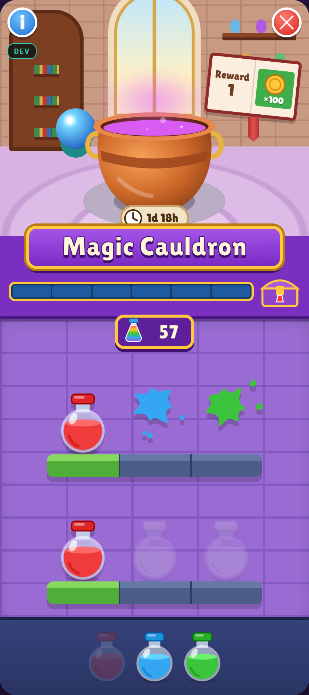
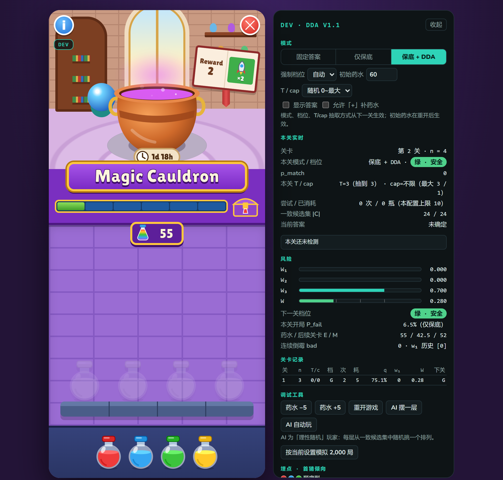
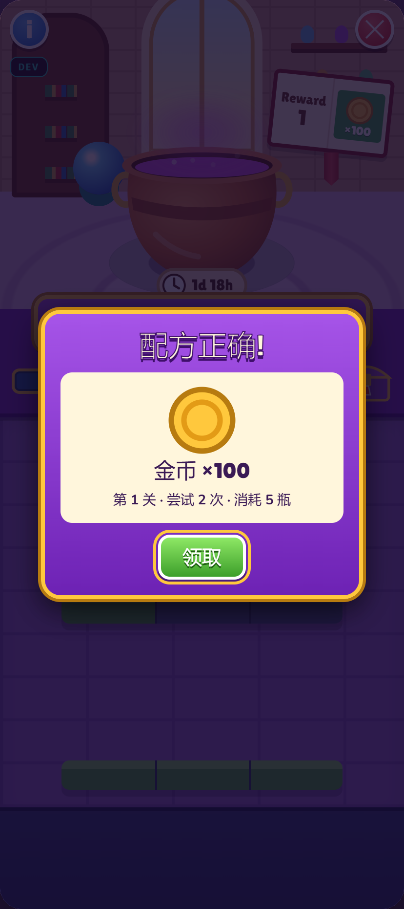

# 魔法坩埚 · Magic Cauldron Demo

> 一个用纯 HTML / CSS / JavaScript 实现的 6 关颜色排列推理玩法 Demo，包含逐格反馈、有限药水预算、动态难度调节（DDA）和可直接操作的开发者面板。

<p align="center"></p>

## 项目简介

玩家用主线关卡产出的药水，在坩埚里摆放颜色瓶，通过逐格反馈推理出正确配方。每次摆放都消耗药水，因此试错有成本；正确的位置会被锁定带入下一层，错误的位置会碎裂并留下颜色印记。

这个 Demo 把重点放在两件事上：

1. **核心循环是否成立**：摆放 → 检测 → 推理 → 修正，资源约束让玩家认真推理，而不是随手乱试。
2. **失败体验是否可控**：用保底进展、答案一致性、随机难度参数和 DDA，让理性玩家尽量不因运气失败；即使失败，也发生得早、说得清楚。

**在线试玩：** https://kamenriderw.github.io/magic-cauldron-demo/

完整设计说明见 [`docs/DESIGN.md`](docs/DESIGN.md)，数值与 DDA 细节见 [`docs/DIFFICULTY.md`](docs/DIFFICULTY.md)。

> 本项目为非官方学习/研究 Demo，参考了 Royal Match 的「Magic Cauldron」活动玩法，与 Royal Match、Dream Games 无任何关联。所有美术均由 CSS / SVG 绘制，不包含原作素材。代码以 MIT License 开源；涉及原作名称、玩法与商标的商业使用，请自行评估相关风险。

## 特性

- **单文件运行**：`magic-cauldron.html`，无构建、无依赖、可离线打开（仅标题字体从 Google Fonts 加载，离线时使用系统字体回退）
- **6 个关卡**：3 / 4 / 4 / 5 / 5 / 6 格，颜色数等于格数
- **完整交互**：药水飞入、点击取回、摆满自动检测、碎裂墨迹、台子拖动回看、按层吸附
- **可解释的难度**：保底进展、答案延迟确定、T / cap 随机、三路风险 DDA
- **开发者面板**：模式切换、强制档位、显示答案、AI 摆一层 / 自动玩、一键模拟 2,000 局
- **可复现的数值**：穷举 + 蒙特卡洛脚本见 [`tools/`](tools/)，结论见 [`docs/VERIFICATION.md`](docs/VERIFICATION.md)

## 快速开始

### 直接打开

双击 `magic-cauldron.html`，用 Chrome / Edge / Firefox / Safari 最新版打开即可。

### 本地服务器（可选）

```bash
python -m http.server 8000
# 浏览器访问 http://localhost:8000/magic-cauldron.html
```

### GitHub Pages

仓库根目录提供一个 `index.html`，会自动跳转到 `magic-cauldron.html`。在 **Settings → Pages** 中选择「Deploy from a branch」→ 分支根目录即可。

## 玩法规则

1. 点击底部托盘中的药水瓶，瓶子飞到台子最左侧的空格，药水 −1。
2. 提交前点击台子上的瓶子可以取回，药水 +1。
3. 台子摆满后自动检测：
   - 位置正确的瓶子保留，格子变绿并锁定；
   - 位置错误的瓶子碎裂，在墙上留下该颜色的印记。
4. 台子自动上移，露出新的一层；已锁定的正确瓶子会带下来，下次只需补未锁定的格子。
5. 全部正确后，瓶子依次飞向坩埚，领取奖励并进入下一关，共 6 关。
6. 如果当前层还需要的瓶数大于剩余药水，立即判定失败，从第 1 关重新开始。

## 设计要点

### 资源约束

药水是步数的硬上限。每次摆放都消耗 1 瓶，摆错不会返还，只有提交前主动取回才返还。玩家因此会珍惜每一次尝试，倾向于认真推理而不是穷举乱试。

### 逐格反馈与推理

检测只告诉玩家「哪些位置正确」，错误位置留下颜色印记。颜色印记相当于排除线索，玩家可以逐步缩小候选排列。答案不是开局写死的，而是在每次检测时从与历史反馈一致的排列中选取，因此回看历史不会发现矛盾。

### 步数控制

| 阶段 | 规则 | 整局平均步数 | 最坏步数 |
|---|---|---|---|
| ① 固定答案 | 开局写死答案 | 64.8 | 127 |
| ② 保底进展 | 每次至少标对 1 格 | 49.9 | 61 |
| ③ 固定难度参数 | n ≥ 4 时固定 T / cap | 61.7 | 67 |
| **④ 随机 T / cap + DDA（最终版）** | 每关在 0 ~ 最大值之间抽取 | **53.6** | **67** |

最终版以 60 瓶药水开局：通关局平均 53.6 步，失败率约 2.9%，87.1% 的通关局落在 50–60 步之间。完整推导、穷举结论和分布表见 [`docs/DIFFICULTY.md`](docs/DIFFICULTY.md)。

### 动态难度调节（DDA）

每关结算时计算三项风险：

| 维度 | 含义 | 权重 |
|---|---|---|
| W₁ 相对运气 | 与同 T / cap 配置的玩家相比，本关是否明显更倒霉 | 0.35 |
| W₂ 连续失利 | 负体验是否在累积 | 0.25 |
| W₃ 经济压力 | 剩余药水是否足以打完后续关卡 | 0.40 |

加权得到 W，映射为绿 / 黄 / 橙 / 红四档；下一关按 0% / 30% / 60% / 90% 的概率触发倾向匹配，在保底集合内选择标对更多的答案（n = 3 不启用，首次检测不直接给全对）。初始 60 瓶时，DDA 把失败率从 5.9% 降到 2.9%。

## 开发者面板

窗口宽度大于 860px 时默认显示在右侧；窄屏时点击左上角「DEV」从底部弹出。

- **模式**：固定答案（对照组）/ 仅保底 / 保底 + DDA
- **参数**：强制档位、初始药水、T / cap 抽取方式、显示答案、允许「+」补药水
- **实时数据**：本关 T / cap、尝试次数与消耗、一致候选集大小、上次检测原因
- **风险面板**：W₁ / W₂ / W₃ / W、下一关档位、本关开局失败概率
- **工具**：AI 摆一层、AI 自动玩、页面内模拟 2,000 局、首猜倾向埋点

## 项目结构

```
magic-cauldron-demo/
├─ magic-cauldron.html          # 单文件 Demo（直接运行）
├─ index.html                   # GitHub Pages 跳转页
├─ README.md
├─ LICENSE
├─ docs/
│  ├─ DESIGN.md                 # 玩法与体验设计
│  ├─ DIFFICULTY.md             # 步数、T/cap、DDA 与失败体验
│  └─ VERIFICATION.md           # 数值验证方法与复现
├─ tools/                       # Python 3 验证脚本（无第三方依赖）
│  ├─ exact_worst_case.py
│  ├─ sim2.py
│  ├─ run.py
│  ├─ walk.py
│  └─ trace.py
└─ screenshots/
   ├─ gameplay.png
   ├─ dev-panel.png
   └─ level-clear.png
```

## 数值验证

`tools/` 中的脚本对应 V1.1 基线模型（保底进展 + DDA）。最终随机 T / cap 版本的单关分布与整局模拟内置于 Demo 的开发者面板，可直接点击「按当前设置模拟 2,000 局」复现。

```bash
python tools/exact_worst_case.py 4   # 精确穷举 n=4 的最坏尝试次数 / 消耗
python tools/sim2.py                 # 各 n、各干预档的单关消耗分布
python tools/run.py                  # 不同初始药水下的整局失败率与 P_fail 表
```

方法与模型假设见 [`docs/VERIFICATION.md`](docs/VERIFICATION.md)。

## 截图

| 开发者面板 | 通关结算 |
|---|---|
|  |  |

## 演示视频

[Bilibili：魔法坩埚玩法 Demo（约 3.5 分钟）](https://www.bilibili.com/video/BV1yBxs6CEn6/)

视频含中文配音与字幕；配音为 AI 合成语音，画面为真实运行的 Demo 录屏。

## 已知限制

- 数值基于「理性随机玩家」模型：不会在同一格重复放置已判错的颜色，其余选择随机。真实玩家若重复犯错，不受保底上限保护。
- Demo 不接入主线关卡，初始药水固定为 60 瓶；「+」补药水默认隐藏，仅开发者面板可开启。
- 失败全部集中在第 6 关，这是沉没成本最高的位置；进一步规避方案（进第 6 关前强制干预、失败续玩等）尚未实现。
- 未做音效、多语言和无障碍的完整适配。

## License

本项目使用 [MIT License](LICENSE) 开源，版权信息见 LICENSE 文件。
