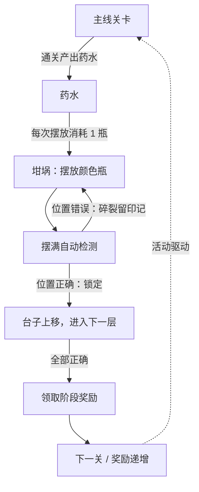

# 玩法与体验设计

本文说明 Demo 的核心循环、规则、关卡配置和交互设计。数值推导与 DDA 细节见 [`DIFFICULTY.md`](DIFFICULTY.md)，复现方法见 [`VERIFICATION.md`](VERIFICATION.md)。

## 1. 设计目标

这不是一个追求内容量的关卡游戏，而是一个可以反复试玩、观察体验问题的玩法原型。设计目标按优先级排列：

1. **核心循环成立**：玩家愿意为了「推理出配方」而消耗有限的药水。
2. **规则可解释**：玩家能看懂为什么对、为什么错、还差多少。
3. **失败可控**：理性玩家尽量不因运气失败；即使失败，也发生得早、原因清楚。
4. **数值可验证**：关键结论能用穷举和模拟复现，而不是拍脑袋估算。

## 2. 核心循环

- **内循环（坩埚）**：摆放 → 反馈 → 推理 → 修正。每次反馈都会缩小答案范围，乐趣来自「我推理出来了」的掌控感，以及接近答案时的期待感。
- **资源约束**：每放一瓶消耗一瓶药水，试错有成本。玩家会珍惜每一次尝试，倾向于认真推理，而不是随手乱试。
- **外循环（活动）**：限时、分关卡、奖励递增，配合进度条和奖励书，给玩家持续的「再解一个」的动力；药水来自主线关卡，活动反过来成为主线活跃的放大器。

## 3. 规则（Demo 实现）

第 k 关有 n 个格子和 n 种颜色，答案是这 n 种颜色的一个排列，每种颜色恰好出现一次。最多 6 种颜色。

1. 点击底部托盘中的药水瓶，瓶子飞到台子最左侧的空格，药水 −1。
2. 提交前点击台子上的瓶子可以取回，药水 +1。
3. 台子摆满后自动检测：
   - 位置正确的瓶子保留，格子变绿并锁定；
   - 位置错误的瓶子碎裂，在墙上留下该颜色的印记。
4. 台子自动上移，露出新的一层；已锁定的正确瓶子会带下来，下次只需补未锁定的格子。
5. 全部正确后，瓶子依次飞向坩埚，领取奖励并进入下一关。
6. 如果当前层还需要的瓶数大于剩余药水，立即判定失败，从第 1 关重新开始。

**操作步数** = 放到台子上并参与检测的瓶子数，即药水消耗数。提交前取回的瓶子会返还药水，不计入；已锁定的瓶子会带到下一层，也不重复计数。

**理性玩家**：不会在同一格重复放置已被判错的颜色，其余选择随机。模拟和数值设计都以此作为基准。

## 4. 关卡与奖励配置

| 关卡 | 格数 n | 可选颜色 | 奖励 | T 最大值 | cap 最大值 |
|---|---|---|---|---|---|
| 1 | 3 | 3 | 金币 ×100 | 0 | 0 |
| 2 | 4 | 4 | 火箭 ×2 | 3 | 1 |
| 3 | 4 | 4 | 无限生命 30m | 3 | 1 |
| 4 | 5 | 5 | 炸弹 ×2 | 3 | 2 |
| 5 | 5 | 5 | 光球 ×2 | 3 | 2 |
| 6 | 6 | 6 | 大宝箱 ×1 | 3 | 2 |

- 颜色数等于格数，每关只考排列顺序，每种颜色恰好出现一次。
- 初始药水 60 瓶，所有参数集中在 `magic-cauldron.html` 顶部的 `CONFIG` 中。
- T：第 T 次检测之前不会判全对；cap：全对之前单次检测最多标对几格。两者每关在 0 ~ 最大值之间均匀随机，0 表示不限制。

## 5. 与原作的差异

| 原玩法 | Demo 中的处理 |
|---|---|
| 药水来自主线三消关卡，按难度产出 | 不接入关卡，固定初始 60 瓶，便于控制总步数；「+」补药水默认隐藏 |
| 活动约 15 步、限时、隔周轮换 | 6 关，格数 3 / 4 / 4 / 5 / 5 / 6；倒计时仅作展示 |
| 可选颜色可能多于格子数 | 颜色数 = 格子数，最多 6 种颜色 |
| 奖励实际发放到背包 | 只做奖励展示与领取弹窗，不做背包 |
| 美术、音效、角色剧情 | 场景、瓶子、坩埚、墨迹全部用 CSS / SVG 绘制，无音效、无剧情 |
| 服务端下发活动配置 | 所有配置集中在 `CONFIG`，进度保存在浏览器 `localStorage` |

## 6. 交互与表现

**摆放与取回**

- 点击托盘药水，瓶子沿弧线飞入台子空格，药水数扣减并伴随计数动画。
- 摆满即自动提交，去掉了多余的「熬制」按钮；未摆满时可以随时点击瓶子取回并返还药水。
- 台子支持拖拽、滚轮、惯性滚动和按层吸附，可以回看之前的每一次排列；回看时出现「回到当前」按钮，再次放瓶时自动回到当前层。

**检测与反馈**

- 正确的瓶子跳动、格子变绿并打上闪光；错误的瓶子晃动后碎裂，在墙上留下颜色印记。
- 台子上移并露出新层，锁定的瓶子随之下移；新层会闪烁提示。
- 回看历史时，错误颜色印记保留，玩家可以直接看到每一格排除过哪些颜色。

**结算与失败**

- 通关时瓶子依次飞向坩埚上方倾倒，液体变色并迸发粒子，随后弹出奖励结算。
- 失败一旦满足条件立即判定，不让玩家继续摆注定失败的瓶子；弹窗写明还差几瓶、只剩几瓶、止步第几关。
- 通关或失败后统一重开，关卡进度和开发者面板中的运行数据一并清空，面板设置保留。

## 7. 失败体验框架

失败本身不是问题，「努力推理却因运气或经济原因失败」才是负体验。Demo 将负体验拆成五类：

| 类型 | 表现 | 设计回应 |
|---|---|---|
| 经济性失败 | 推理还没结束，药水先用完了 | 保底进展 + DDA + 60 瓶预算 + 提前失败判定 |
| 无进展挫败 | 连续多次一格都没标对 | 保底进展：理性玩家每次至少标对 1 格 |
| 被戏耍感 | 答案与之前的反馈矛盾，或被系统卡住 | 答案一致性：只从与历史反馈一致的排列中选答案 |
| 无效操作 | 已经注定失败，却还让玩家继续摆瓶 | 当前层需要的瓶数 > 剩余药水时立即判定失败 |
| 不可预期 | 不清楚为什么失败、还差多少 | 失败弹窗写明数量与关卡；颜色印记提示已排除颜色 |

具体推导、风险模型和数值结果见 [`DIFFICULTY.md`](DIFFICULTY.md)。

## 8. 已知限制与后续方向

- 数值基于「理性随机玩家」模型。真实玩家如果重复在同一格放已判错的颜色，不受保底上限保护；颜色印记和托盘提示可以缓解，但不能完全避免。
- 失败集中在第 6 关，这是沉没成本最高的位置。可选方案：进入第 6 关前若失败概率超过阈值，强制红档；失败时提供「补少量药水续玩」；用真实玩家埋点替换理性随机模型。
- 未实现音效、角色剧情、多语言和无障碍的完整适配。
- Demo 未接入主线关卡和真实付费/广告埋点，药水经济只做了固定预算的简化。

## 9. 可扩展方向

- 把 `CONFIG` 抽成关卡配置表，支持更多关型和活动周期。
- 接入真实埋点，对首猜倾向、取回频率、单关消耗分位做线上校准。
- 用服务端下发活动配置和答案候选集，前端只负责表现。
- 增加「补药水续玩」「看广告补药水」「道具」等商业化点位，但需要重新评估失败率和步数预算。
